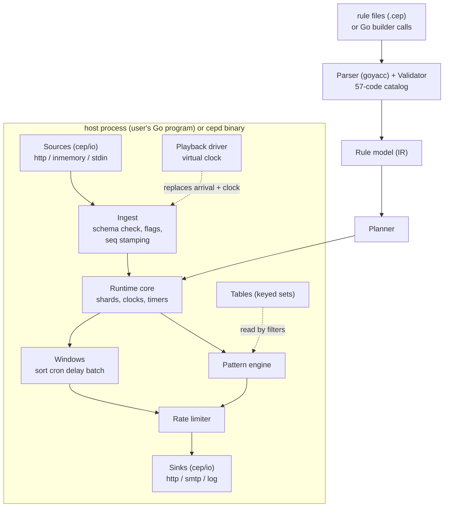
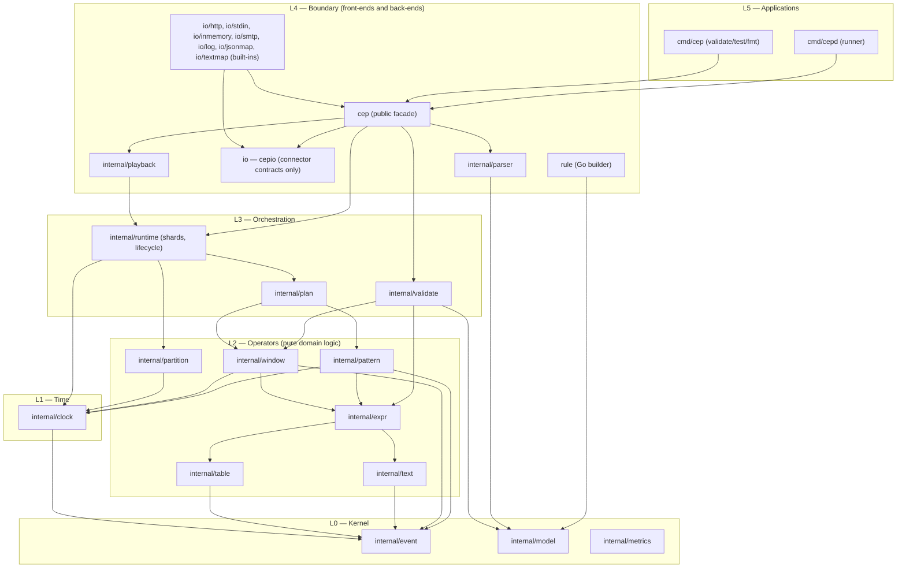
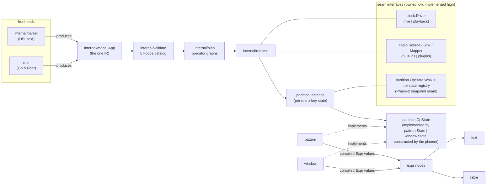
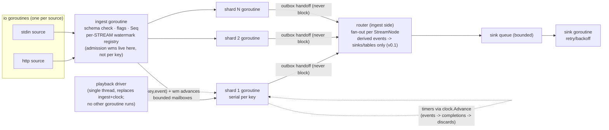
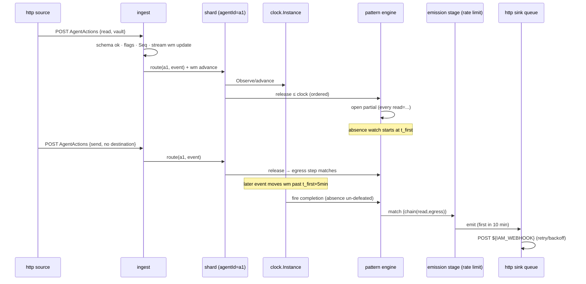
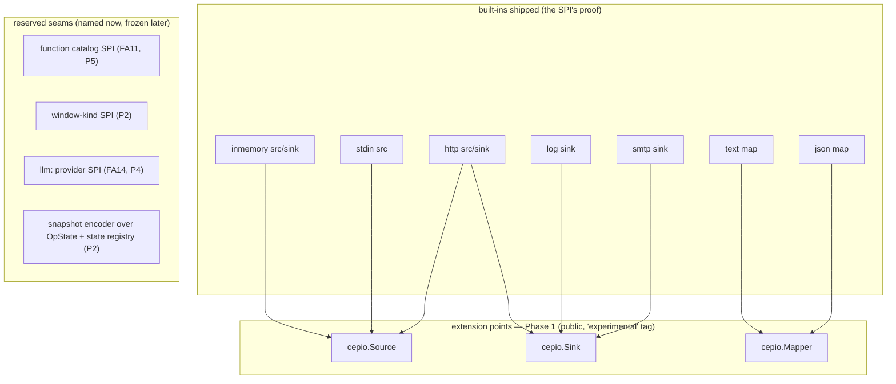

# Architecture Baseline — complex-events-engine (Phase 1)

**Status:** RATIFIED (owner, 2026-11-01) after three adversarial review rounds; the ratification conditions — build-time constraint enforcement, the hostile gate, and the QA strategy — are ADR-0015 and [docs/development/qa-strategy.md](../development/qa-strategy.md).
**Audience:** coding agents implementing Phase 1, and reviewers. Written deliberately verbose and explicit (owner directive 2026-11-01): a coding agent MUST be able to implement from this document plus the named references without inferring anything that is not written.
**Binding inputs this document may not contradict:** the frozen language spec [docs/language/SPEC.md](../language/SPEC.md) (**v0.1 rev 2**, owner-ratified 2026-11-01 — the in-repo file is authoritative; the old `bfab8d5` pin predates rev 2), the semantics [docs/language/SEMANTICS.md](../language/SEMANTICS.md), the roadmap Phase 1 slice [docs/product/02-roadmap.md](../product/02-roadmap.md), the gate and code rules [docs/development/DEVELOPMENT.md](../development/DEVELOPMENT.md), the test contract [docs/development/testing.md](../development/testing.md). Where this document and those disagree, those win and this document is fixed.
**Decisions:** every numbered decision lives in an ADR under [adr/](adr/). This file is the map; the ADRs are the law.

---

## 1. What Phase 1 builds (one paragraph)

An embeddable, single-node Go library (plus a thin binary) that: parses rule files written in the frozen CEP language v0.1 (or accepts the same rules built through a typed Go API), validates them against the 57-code error catalog, compiles them to an executable rule model, and runs them over event streams with exactly the semantics of SEMANTICS.md — event-time watermarks, continuously-monitored absences, per-key partitions with TTL, four window kinds, deterministic text matching, and rate-limited alert output — deterministically replayable in playback mode, demonstrated end-to-end by the Agent Kill Switch scenario and the attack gallery.

## 2. System context



Everything runs in one process. There is no server, no cluster, no external store in Phase 1. The same engine object runs live (real arrival, wall-clock-driven idleness) and in playback (virtual clock, byte-identical outputs) — one code path, two clock implementations (ADR-0005).

## 2a. The layer model (normative)

The engine is a **strictly layered architecture**. A package lives in exactly one layer; a package MUST import only packages in layers **below** its own, plus the named same-layer edges in §3's exception table (L4: `cep → parser`, `cep → playback` for the Deploy pipeline and its expect sandbox, `cep → io` — the facade's API uses the connector contracts — and `io/* → cep, io` — each built-in connector is its own sub-package consuming only the public facade and contracts; **amended 2026-11-02 by owner decision: the former `io → cep` edge plus `cep`'s use of `cepio.RowWriter` formed a Go import cycle**; L2: `expr → text, table`, `pattern`/`window → expr` interface-only). The import-DAG gate check enforces layers and exception table together, mechanically.



**Layer charter (what each layer is allowed to know):**

| Layer | Packages | Knows about | MUST NOT know about |
|---|---|---|---|
| L0 Kernel | `event`, `model`, `metrics` | nothing but stdlib; `metrics` is importable by every internal package (counters are L0 data) | time, operators, I/O, parsing |
| L1 Time | `clock` | events (timestamps, order) | what operators do with releases/timers; I/O; rules |
| L2 Operators | `pattern`, `window`, `expr`, `text`, `table`, `partition` | events + the clock handles they are given; the §3 exception-table edges (`expr → text, table`; `pattern`/`window → expr` interface-only); sanctioned x/text inside `text` | each other beyond those edges; runtime; I/O; parsing; wall clock |
| L3 Orchestration | `runtime`, `plan`, `validate` | model + operators + clock; wires them | sources/sinks internals; parse trees |
| L4 Boundary | `cep`, `rule`, `io`, `parser`, `playback` | the public contract and the model | operator internals (reach runtime only through its API) |
| L5 Applications | `cmd/*` | public packages only | anything `internal/` |

**The dependency-inversion seams** (interfaces defined low, implemented high): `clock.Driver` (implemented by live runtime and playback), `cepio.Source/Sink/Mapper/RowWriter` (implemented by built-ins and future plugins; RowWriter is the public value boundary), `partition.OpState` (implemented by every stateful operator type; walked via the state registry by the Phase-2 snapshotter). These three seams are the only places the arrow of knowledge points "up", and each is an interface owned by the lower layer.

## 2b. Design-quality bar (normative — owner directive 2026-11-01)

**No tactical code.** Implementation serves the layer model even when a shortcut would pass the tests. Concretely, each of these is a review-blocking finding (architect review of every combined diff, sprint model §8), and the first four are mechanically gated:

1. An import that violates the layer table (gate: importcheck).
2. Time read outside `internal/clock` handles (gate: lint allowlist).
3. A goroutine outside `internal/runtime` (which owns ingest/router, shards and the sink flushers), the built-in connector packages `io/*` (their own I/O only — e.g. an HTTP listener) or `cmd/*` (gate: `puritycheck`, **module-wide** — ADR-0015 §2; the one goroutine allowlist, stated once).
4. Package-level mutable state (gate: `globalscheck` with const-like defined in the analyzer — ADR-0015 §2; DEVELOPMENT.md).
5. An operator reaching around `clock.Instance` to compute a watermark, deadline or ordering itself — even correctly.
6. A type exported from `internal/*` solely so another package can poke its fields: define the seam interface instead.
7. Special-case branches keyed on *which rule* or *which example* is running (the kill-switch is a corpus member, never a code path).
8. Copy-pasted logic between operators where a shared L0/L1 helper belongs — or the inverse sin, a premature "framework" generalizing from one use. The bar is: the abstraction exists in SEMANTICS.md's vocabulary (watermark, contribution, partial, instance) — code mirrors that vocabulary, no more, no less.

*A fix that cannot meet the bar in its sprint is not merged with a TODO; it goes back to the plan check (sprint model: finish or revert).*

*Rules 5–8 are review-only — no analyzer can see them. The full review-only residue (seven items, these four among them; *an eighth (the gate's Python has no coverage floor) and a ninth (unpinned git, make and bootstrap Python), both added 2026-11-02 by owner decision*) is recorded in ADR-0015 §3.6 and was accepted knowingly by the owner (2026-11-01).*

## 3. Repository and package layout (normative — ADR-0001)

Module path: `github.com/vorsar/complex-events-engine` *(amended 2026-11-02, owner decision: **`github.com/vorsar/cep`**; the repository is `VORSAR/cep`; ADR-0001 §1)*. One Go module at the repo root. Go version pinned in `go.mod` (`go` + `toolchain` lines) per DEVELOPMENT.md.

```
cep.go, runtime.go, event.go, errors.go   package cep        — public embeddable API
rule/                                     package rule       — public generics rule-builder API
io/                                       package io (cepio) — the public connector contracts ONLY: Source/Sink/Mapper/RowWriter/EmitFunc/OutEvent/Mode + the batch-close signal (a leaf: imports no module package)
io/http, io/stdin, io/inmemory, io/smtp, io/log, io/jsonmap, io/textmap   one package per built-in connector; each imports cep + io only (owner decision 2026-11-02 — breaks the cep↔io cycle)
cmd/cepd/                                 the binary runner (rule files + config per ADR-0008 §5); serves /metrics (Prometheus text) + /healthz (round-2 F16)
cmd/cep/                                  the CLI: validate / test / fmt
internal/event/                           canonical event + schema (value union, flags, seq)
internal/model/                           the rule-model IR (single source of truth, ADR-0003)
internal/parser/                          lexer, goyacc grammar (cep.y), AST, AST→model lowering, and the canonical printer (SPEC §9 formatter; round-trip law parse→print→parse; drives `cep fmt`; *placement amended at the approved Phase-1 decomposition, 2026-11-02:* the lexer keeps comments as positioned trivia in sprint S2.1, and the printer + `cep fmt` land in sprint S6.2 — round-2 F10) *(annotated 2026-11-04, owner: participle v2 struct-tag grammar (`grammar.go`), no `cep.y`, no generated file; ADR-0002 as amended)*
internal/validate/                        static checks; the error catalog as a data table
internal/plan/                            model → executable graph (operators wired per rule)
internal/clock/                           watermarks: admission/contribution, punctuations, timers (ADR-0004)
internal/runtime/                         shards, mailboxes, key router, engine loop (ADR-0006)
internal/partition/                       key extraction, instance lifecycle, TTL purge
internal/expr/                            compiled expression trees, typing, the callable registry (ADR-0011)
internal/pattern/                         partial-match engine (steps, absences, completion; ADR-0013)
internal/window/                          sort, cron (own 5-field parser), delay, batch (ADR-0014)
internal/text/                            normalization (x/text), tokenizer, Aho-Corasick, regex wrappers (ADR-0007)
internal/table/                           in-memory keyed tables, snapshot-per-event reads
internal/playback/                        virtual clock, merged-log format, expect runner (ADR-0005)
internal/metrics/                         counters + Prometheus text exposition (no client lib)
conformance/                              the golden suite + corpus runner (test-only package; the expect sandbox it drives lives in internal/playback; owner 2026-11-02: imports PUBLIC packages only — it proves the real product path — and nothing imports it)
bench/                                    benchmark suite + scenario generators (ADR-0010 §8; owner 2026-11-02: may import internal packages to time stages; nothing imports it)
gallery/                                  the attack gallery: runnable rule apps + playback logs + expects (roadmap exit criterion 5; conformance executes them)
demo/                                     the kill-switch demo kit: compose file, traffic generator, stub IAM, mail catcher (exit criterion 1; trailing sprint — round-2 F17)
docs/language/                            the frozen spec (already exists; grammar.lark is normative)
gate/                                     registry.json, run.sh, summary logic, law.json, regen-baseline (ADR-0015) — annotated 2026-11-02 (owner, S1.1a plan check): the gate's code is stdlib Python run by a pinned CPython — bootstrap.py, run.py, runner/, toolchain/, coverage/, ci/ — not shell
gate/proofs/                              planted-defect proof fixtures — a SEPARATE Go module, never imported (ADR-0015 §3.4) — annotated 2026-11-03 (S1.1a-1 as built): also holds Python outside that module, the drivers (proofs/drivers/) and the proofs row (proofs/row.py); its packages under gate/proofs/internal/ belong to the nested module, not to this table. Beside them: gate/wait.py and gate/term.py (shared helpers), ruff.toml beside tools.json at the root, and .gate/ (run output, git-ignored)
tools/analyzers/                          the gate's go/analysis analyzers + testdata fixtures + teeth_test.go (ADR-0015 §2)
tools/importcheck/rules.json              the layer law, diffed against this §3 as parsed edges (ADR-0015)
tools/allowlists/, tools/deps-allowlist.json  the one allowlist grammar (ADR-0015 §3.10)
tools/kwgen/                              keyword-table generator (ADR-0002) *(annotated 2026-11-04: not built; the keyword table is pinned equal to `grammar.lark` by a test in `internal/parser` instead)*
api/exports.golden                        the hand-written public-export law file (ADR-0015 §2 apipartition)
.githooks/, Makefile, tools.json          the gate (ADR-0005; DEVELOPMENT.md is the doctrine; ADR-0015 the mechanism catalog)
```

**Import rules (MUST; enforced by a gate check).** *Owner decision 2026-11-02: where a rule below lists the packages a package may import, the list is **exhaustive** — §2a's "any lower layer" is the outer bound, not a licence; a connection not listed here or in the exception table is red, and adding one is a `rules.json` change visible in the LAW Δ block.*
1. `internal/event` imports nothing from this module. Everything else may import it.
2. `internal/model` imports only `internal/event`.
3. `internal/parser` and package `rule` import `internal/model` (both are front-ends; neither imports the other).
4. `internal/plan` imports `model`, `expr`, `partition` (instance/OpState construction) and the operator packages (`pattern`, `window`, `text`, `table`); plan's emission stage owns rate limiting (anchors live in `partition.Instance` — the former one-if `ratelimit` package is folded here per the round-2 elegance note). `internal/validate` imports `model`, `expr` (typing tables), and `window` (the `windowspec` extent helper) — all downward.
5. Operator packages (`pattern`, `window`, `expr`, `text`, `table`, `partition`) import `event` and `clock` only — never `runtime`, never `io`, never each other — except the **exception table** (exhaustive; the gate enforces it verbatim):

   | Edge | Why |
   |---|---|
   | `expr → text` | text-operator nodes call the matching evaluators (ADR-0011 §5) |
   | `expr → table` | `in`-membership nodes read table snapshots (ADR-0011 §1) |
   | `pattern → expr`, `window → expr` | interface type only — they receive compiled `expr.Expr`/`Row` values from the planner |
   | any `internal/*` → `metrics` | counters are L0 data (round-2 F16) |
   | `expr → model` | *(added 2026-11-04, owner decision at S2.2a after an adversarial review)* `expr.Build` compiles the IR's expression node (ADR-0011 §2); fenced in `rules.json` to the model's expression types only, enforced by `archcheck` |
   | `cep → parser` (L4 same-layer) | the Deploy pipeline's front end (§2a; consistency review S4 — the edge was named in §2a but missing here) |
   | `cep → playback` (L4 same-layer) | the Deploy pipeline's expect sandbox (ADR-0005 §4) |
   | `cep → io` (L4 same-layer) | the facade's API (`Table.Upsert`, `InputHandler.SendRow`, source/sink registration) is written in the connector contracts' types; `io` is a leaf, so no cycle (owner decision 2026-11-02 — replaces the former `io → cep` row, which with this edge formed an import cycle) |
   | `io/* → cep`, `io/* → io` (L4 same-layer) | each built-in connector sub-package consumes only the public facade and the contracts (round-3 R4's intent, kept) |
6. `internal/runtime` imports `clock`, `partition`, `plan` and the operator packages; it is the only package that owns goroutines besides `io` and `playback`.
7. Public packages (`cep`, `rule`, `io`) never appear in an `internal/*` import list — the engine never imports its own facade.
8. No package anywhere imports `cmd/*`.

## 4. The canonical event (normative)

Defined in `internal/event`; the public `cep.Event` is a thin view over it.

> *Amended 2026-11-02 (owner decision at S1.1a-1's design review, option "(b+)"; the definitions below are kept as ratified, and this note overrides them).* Two zero values silently looked like real data, so they are closed:
> 1. **`Type`:** `TInvalid` is the zero `Type` (an unset slot; never a declared type, never a null; nulls keep their declared type), so `TString` = 1 … `TObject` = 7.
> 2. **`Schema`:** its fields are **private**, built only by `NewSchema(stream, attrs, timeAttr)` and read through `Stream()`, `NumAttrs()`, `Attr(i)` and `TimeAttr()`, with `ArrivalTime = -1` for `time arrival`. `NewSchema` rejects:
>    - an empty stream name;
>    - zero attributes;
>    - an empty or duplicate (case-sensitive) attribute name;
>    - an invalid attribute type;
>    - an out-of-range time index;
>    - a non-timestamp time attribute (also a coded deploy error in S1.2's spec rev 3).
>
> The exact surface is [s1-1a-gate-design.md §1](../sprints/s1-1a-gate-design.md). `Type` numbers are never encoded: S1.2's canonical encoding writes type names.

```go
// internal/event/event.go
type Type uint8
const (
    TString Type = iota; TInt; TFloat; TBool; TTimestamp; TDuration; TObject
)

type Attr struct {
    Name     string
    Type     Type
    Optional bool   // declared `optional` in the schema; non-optional null at ingest = stream error
}

type Schema struct {
    Stream   string
    Attrs    []Attr   // declaration order; index = attribute id used everywhere downstream
    TimeAttr int      // index of the event-time attribute, or -1 for `time arrival`
    // watermark strategy + idle duration live on the stream declaration in the model
}

// Value is a tagged union. NULL REPRESENTATION (one way only, round-2 F21): a null is
// Value{Null: true} with Kind retaining the attribute's DECLARED type (so typing never
// depends on nullness); there is no null Kind. Object is opaque (any), supports only
// is-null checks per SPEC §5.10.
type Value struct { Kind Type; Str string; I int64; F float64; B bool; T int64; D int64; Obj any; Null bool }

type Event struct {
    StreamID  int      // index into the app's stream table (declaration order = SPEC §2.2 stream id)
    Ts        int64    // event time, UTC milliseconds (SEMANTICS §1)
    Seq       uint64   // per-stream ingestion sequence, assigned at ingest (SEMANTICS §2.2)
    Values    []Value  // aligned to Schema.Attrs
    Invisibles bool    // text_invisibles flag, computed once at ingest (SEMANTICS §5.1)
    BatchID   string   // source batch id, "" when the source does not punctuate
}
```

**Total order (MUST, SEMANTICS §2.2):** events are ordered by `(Ts, StreamID, Seq)`. `StreamID` is declaration order in the app file. Every buffer that releases events sorts by exactly this key. There is no other ordering anywhere.

## 5. Dataflow walkthrough (the kill-switch rule, end to end)

This narrative is normative for component responsibilities. Rule: [docs/language/examples/01-agent-kill-switch.cep](../language/examples/01-agent-kill-switch.cep).

1. **Deploy.** `cep.Runtime.Deploy(appSource)` → `internal/parser` lexes and parses (goyacc; a parse error carries line/col and one of the 23 parse codes) → AST → lowering to `internal/model.App` → `internal/validate` runs every static rule in [docs/language/errors.md](../language/errors.md) marked **[static]** (34 codes; the catalog is a table in `internal/validate/catalog.go`, one entry per code, so the gate can assert 1:1 coverage) → `internal/plan` builds one executable graph per rule: ingest spec → partition router spec → operator chain → sink bindings. Alternatively the same `model.App` arrives from package `rule` (the Go builder); from `model` onward the path is identical — this is what the parity test proves (ADR-0003). *(Annotated 2026-11-04, owner: the parser is participle v2, not goyacc; ADR-0002 as amended.)*
2. **Ingest.** A source (`io/http`) delivers a JSON event for `AgentActions`. The router validates it against the schema — runtime policy (round-2 F23): an UNKNOWN attribute in the payload is skipped without materialization (tolerant ingestion, O4; counted in `unknown_attrs`); a MISSING non-optional attribute or a null/absent timestamp is a stream-level event error (drop + log + `errored_events`, SEMANTICS §10); E-NAME-001 is deploy-time only. It then computes `Invisibles` over all string attributes (one pass, `internal/text.IngestFlags`), stamps `Seq`, and hands it to the runtime.
3. **Routing.** The router (ingest side) evaluates the rule's compiled key expression (an `expr.Expr`) for this stream (`agentId`) — null key = per-rule event error — hashes the key to a shard, and enqueues `(instanceKey, event)`; the stream's watermark advance (if any) follows as a control message to every shard (ADR-0004 §3), so even quiet keys' clocks move.
4. **Clocking.** `internal/clock` tracks, per stream: admission watermark `max(Ts seen) − d` (monotonic). Per rule instance it tracks the construct clock: `max(previous, min over input streams of contribution)` where contribution = admission wm raised by idleness (live) or the virtual clock (playback) — SEMANTICS §2.1 as pinned. Events behind their stream's admission wm are stream-late (dropped + counted); events behind the construct clock are construct-late (dropped + counted separately).
5. **Ordering.** Per rule instance, admitted events buffer in a min-heap keyed by `(Ts, StreamID, Seq)` and release when `Ts ≤ construct clock`, in order.
6. **Matching.** `internal/pattern` consumes released events: the `every read = …` step opens a partial per qualifying read; the absence constraint (`and not HumanApprovals[…] for …`) is monitored continuously from each partial's `t_first` — a qualifying approval defeats the partial immediately, even before the egress step matches (SEMANTICS §6.4). At each construct-clock advance the engine performs, in this exact order: (a) release buffered events, (b) fire due completions/absence resolutions, (c) discard overrun partials (SEMANTICS §6.4 "watermark-advance ordering"). Completion emits named captures + `chain(read, egress)` with original attribute values, match end = max(last positive Ts, absence deadlines).
7. **Rate limiting.** The plan's emission stage holds one anchor per (rule, key) in `partition.Instance`: an output with `Ts ≤ anchor + D` is suppressed + counted; otherwise it emits and re-anchors.
8. **Emission.** The shard appends the match to its **outbox** and continues; the router drains outboxes, delivering sink-bound events to the sink's bounded queue (full queue ⇒ the ROUTER waits — backpressure reaches sources, never shards; ADR-0006 §5 carries the deadlock-freedom argument) and derived-stream events to their sink/table bindings only — **v0.1 rules cannot consume derived streams** (owner decision 2026-11-01; ADR-0004 §6, ADR-0012 §1), so nothing re-enters routing. The `@sink(type='http')` flusher posts JSON in coalesced batches with retry/backoff (at-least-once, stated).
9. **TTL.** When a key's construct clock passes `last activity + ttl`, `internal/partition` destroys the instance: partials, completion marks, rate anchors; a changelog window would first emit retractions (SEMANTICS §9).

## 5a. Architectural views (diagrams — owner directive 2026-11-01)

### View 1 — Components and the three inversion seams



### View 2 — Concurrency: goroutines, mailboxes, queues (every goroutine in the system appears here)



Rules this picture encodes: sources and sinks own the only I/O goroutines; **the per-stream admission watermarks live in ingest's registry and their advances are broadcast to shards** (a quiet key still sees its streams' clocks move — ADR-0004 as revised per pre-mortem finding 1); shards never block on sinks; playback is one thread.

### View 3 — The kill-switch event path (sequence)



### View 4 — Plugin/SPI view (what extends today, what is reserved)



Sibling-repo adapters (decision #10) implement exactly the three Phase-1 interfaces; nothing else is a supported extension point until its named phase.

## 6. Concurrency and determinism model (ADR-0006, summary)

- N shards (default `GOMAXPROCS`), each one goroutine, each owning a disjoint set of partition keys (hash routing). **Within a key everything is serial** — no locks in operator code, no shared mutable state between shards.
- Operator packages are **pure libraries**: they own no goroutines, do no I/O, and read time only from `internal/clock` handles passed in (DEVELOPMENT.md: no wall clock in engine logic).
- Goroutines exist only in: `internal/runtime` (shards + the ingest/router + the sink flushers — moved here from `io` by the 2026-11-02 `io` split, ADR-0008 §2), the built-in connector packages `io/*` (source readers and other connector I/O), and `cmd/*` (the `/metrics`+`/healthz` HTTP listener in `cepd` — L5, public-API consumer); `internal/playback` owns none — playback is single-threaded by design. This is the one allowlist `puritycheck` enforces module-wide (ADR-0015 §2; consistency review S6 unified the three divergent statements). Shards never block (bounded work, outbox handoff); only ingest/router blocks, and only toward sources.
- **Playback mode MUST be bit-deterministic:** one thread, events fed in merged-log order, the virtual clock advancing as SEMANTICS §2.1 defines; equal inputs ⇒ byte-identical outputs, asserted by the replay layer of the test contract.
- **Live mode** uses the same operator code; nondeterminism is confined to (a) arrival interleaving across shards and (b) idleness timing — both only affect *when*, and construct-late drops are counted (SEMANTICS §2.1's scoped guarantee).

## 7. Where each SEMANTICS section is implemented (traceability — a gate check asserts this table's files exist, switched on at the release close-out sprint S12, when every package has been built; ADR-0015 §2 docsync)

| SEMANTICS | Package | Proven by |
|---|---|---|
| §1 data model, null | `internal/event`, `internal/validate` (E-NULL lints) | conformance: null cases |
| §2 clocks, watermarks, idleness, order | `internal/clock` | conformance: RT-01/RT-10 ports of `docs/language/checks/` (sprint S4.1, with clock-level unit tests in S3.1); *RT-09 deferred to Phase 2 — it needs a rule consuming a derived stream, which v0.1 rejects (annotated 2026-11-02)* |
| §5 text matching | `internal/text` (+ `internal/expr` operator nodes) | conformance: term/substring/set/regex/fold cases |
| §2.5/§5.10 expressions, typing, functions | `internal/expr` | validator E-TYPE/E-FN tests; Appendix F registry diff |
| §6 patterns | `internal/pattern` | conformance: kill-switch composite + boundary cases |
| §7 windows | `internal/window` | conformance: per-kind golden cases |
| §8 emission, rate limiting, sink modes | `internal/plan` (emission stage incl. rate anchors), `io` | conformance + E-SINK/E-EMIT validator tests |
| §9 partitions, TTL | `internal/partition` | conformance: TTL/purge cases |
| §10 errors, params, determinism | router ingest (stream error policy), `internal/expr` (per-rule expression errors), `internal/validate` (static codes, `${param}` resolution), `internal/playback` (determinism) | validator tests; replay suite |

## 8. What Phase 1 explicitly does NOT build (so agents do not)

No snapshots/restore (Phase 2 — but `internal/runtime` state lives behind interfaces that a snapshotter can walk; see ADR-0006 §"snapshot seam"). No joins, group-by, counting, sequences, `or`-patterns (reserved words; **the parser's keyword table rejects them with E-RES-001** — errors.md marks it [parse]; consistency review S5 fixed this document's wrong "validator" attribution). **No rule-consumption of derived streams** (owner decision 2026-11-01 — a rule reading another rule's output stream is rejected at validation; the error code is assigned in the spec rev-3 batch at S1's plan check; the Phase-2 min-merge watermark design is recorded in ADR-0004 §6). No NATS/Kafka/OTel connectors (sibling repos / Phase 3). No LLM constructs (Phase 4; `llm:` namespace rejected). No hot reload, no management API (Phase 5). No distributed anything, ever in this repo.

## 9. Glossary (for agent briefs)

- **Admission watermark** — per stream: `max(event time seen) − d`; decides stream-lateness. Identical in live and playback.
- **Contribution** — what a stream lends to a rule's clock: admission wm, raised by idleness (live) or virtual clock (playback).
- **Construct clock** — per rule instance: clamped min of its inputs' contributions; drives release, timers, TTL.
- **Partial** — an in-progress pattern match (captures so far, t_first, pending absences).
- **Rule instance** — one rule × one partition-key value; the unit of isolation and TTL.
- **The gate** — the check registry of DEVELOPMENT.md; T0–T4 tiers; exit code is the verdict.
- **Playback** — the deterministic mode: merged log in, virtual clock, byte-identical outputs; the conformance substrate.
